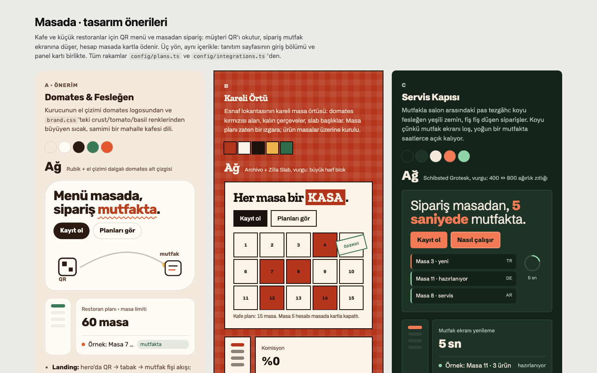

# premium-ui

Claude Code için bir skill: **premium, ürüne özgü arayüzler** ve ürünü anlatan
animasyonlar. Hem tanıtım sayfaları hem de uygulama panelleri, dashboard'lar ve
yönetim ekranları için.

Bir projede çalıştırınca hemen kod yazmaz:

1. **Projeyi inceler.** Ürünün ne yaptığına, mevcut ekranlara, bileşen
   kütüphanesine, gerçek rakamlara (fiyat, limit, zamanlama) ve zayıf noktalara bakar.
2. **Öneri panosu hazırlar.** 2–3 farklı tasarım yönünü canlı mini tasarımlar
   olarak tek sayfada gösterir: renk paleti, fontlar, örnek giriş bölümü ve
   örnek panel kartı, üzerinde çalışan imza animasyonu.
3. **Projeye özel iyileştirmeler listeler.** "Dashboard yer tutucu kutulardan
   oluşuyor → gerçek verili genel bakış" gibi somut öneriler.
4. **Seçtiğiniz yönü uygular** ve her bölümü tarayıcıda masaüstü ve mobilde kontrol eder.



*Skill'in örnek bir Next.js projesi (kurgusal QR menü ürünü "Masada") için
ürettiği öneri panosu. Yönler ürünün dünyasından türetiliyor: logodaki domates
ve fesleğen, esnaf lokantasının kareli örtüsü, mutfakla salon arasındaki servis
kapısı. Her yön kendi paleti, yazı tipi, mini giriş bölümü ve panel kartıyla
gösteriliyor; rakamlar projenin config dosyalarından geliyor.*

## Kurulum

Claude Code'da:

```text
/plugin marketplace add karaarslaneren/premium-ui
/plugin install premium-ui@premium-ui
```

Ya da terminalde:

```bash
claude plugin marketplace add karaarslaneren/premium-ui
```

```bash
claude plugin install premium-ui@premium-ui
```

Güncelleme:

```bash
claude plugin update premium-ui@premium-ui
```

## Kullanım

Doğrudan çağırın:

```text
/premium-ui Bu projenin tanıtım sayfasını ve panelini yeniden tasarla.
```

Ya da sadece isteğinizi yazın. "Premium", "profesyonel", "animasyonlu",
"bu tarzda yap" gibi ifadeler veya bir referans site linki skill'i kendiliğinden
devreye sokar.

İsterseniz ayrıntılı bir brief verin:
[`skills/premium-ui/references/prompt-template.md`](skills/premium-ui/references/prompt-template.md).

## İçerik

| Dosya | Ne anlatır |
| --- | --- |
| [`SKILL.md`](skills/premium-ui/SKILL.md) | Çalışma yöntemi: önce öneri, ürün gerçekleri, token'lar, bölüm bölüm ilerleme, tarayıcıda doğrulama |
| [`direction-finding.md`](skills/premium-ui/references/direction-finding.md) | Tasarım yönlerini ürünün dünyasından türetme; her projede aynı görünümün çıkmasını önleyen eksenler, kurallar ve testler |
| [`type-library.md`](skills/premium-ui/references/type-library.md) | Türlere göre gruplanmış ~125 Google Fonts yazı tipi, karakter notlarıyla; hepsinde Türkçe karakterler doğrulandı |
| [`proposal-board.md`](skills/premium-ui/references/proposal-board.md) | Tasarım yönlerini canlı mini tasarımlarla önerme |
| [`motion-catalog.md`](skills/premium-ui/references/motion-catalog.md) | Animasyon teknikleri ve hazır kodları: scroll reveal, line mask, count-up, SVG akış, sabitlenen bölüm (scroll-pinned), magnetic buton, glow kart, plan önerici, carousel, footer yazısı |
| [`panel-patterns.md`](skills/premium-ui/references/panel-patterns.md) | Panel çerçevesi, bileşen kütüphanesini merkezden temalama, gerçek verili dashboard, giriş ekranları, dil ayarları |
| [`craft-baseline.md`](skills/premium-ui/references/craft-baseline.md) | Tip ve boşluk ölçekleri, erişilebilirlik, performans bütçesi, metin (copy), yükleniyor/boş/hata durumları |
| [`visual-critique.md`](skills/premium-ui/references/visual-critique.md) | Panoyu ve her bölümü kullanıcıdan önce görmek: ekran görüntüsü, altı soru (okunuyor mu, bitmiş mi, kırık mı, kısma, takas, mobil), düzelt ve tekrar çek |
| [`pitfalls.md`](skills/premium-ui/references/pitfalls.md) | Gerçekte yaşanmış, stack'ten bağımsız hatalar ve çözümleri |
| [`stacks/`](skills/premium-ui/references/stacks/) | Stack'e özel tarifler ve hatalar: [Laravel/Livewire/Flux](skills/premium-ui/references/stacks/laravel-livewire.md), [React/Next/shadcn](skills/premium-ui/references/stacks/react-next.md), [Vue/Nuxt](skills/premium-ui/references/stacks/vue-nuxt.md). Skill yalnızca projeye uyanı okur |
| [`prompt-template.md`](skills/premium-ui/references/prompt-template.md) | Doldurulacak istek şablonu |
| [`assets/proposal-board.html`](skills/premium-ui/assets/proposal-board.html) | Öneri panosu şablonu: 3 yön, mini giriş bölümü ve panel, CSS animasyonu |
| [`scripts/verify.js`](skills/premium-ui/scripts/verify.js) | Tarayıcıda çalışan denetim: yatay taşma, tıklama alanı, kontrast, odak, reduced-motion, görsel ve font kontrolleri (JSON rapor) |
| [`scripts/snapshot.py`](skills/premium-ui/scripts/snapshot.py) | Tarayıcı aracı yokken: makinedeki Chrome ile yerel bir HTML dosyasının masaüstü ve mobil ekran görüntüsünü alır, `verify.js` raporunu verir |
| [`scripts/check-fonts.py`](skills/premium-ui/scripts/check-fonts.py) | Seçilen Google Fonts yazı tiplerinde Türkçe karakterlerin (ğ ş ı İ…) gerçekten olup olmadığını font dosyasından kontrol eder |

## İlkeler

- Animasyonlar süs değil, ürünün ne yaptığını anlatır.
- Referans site kopyalanmaz; sadece kalitesi örnek alınır.
- Rakamlar ve iddialar gerçek veriden gelir, uydurulmaz.
- Yalnızca transform/opacity animasyonu, `prefers-reduced-motion` desteği, mobilde yatay taşma yok.
- WCAG AA kontrast, görünür odak, klavyeyle kullanım; `verify.js` her bölümde çalıştırılır.
- Her değişiklik tarayıcıda gerçek etkileşimle kontrol edilir.
