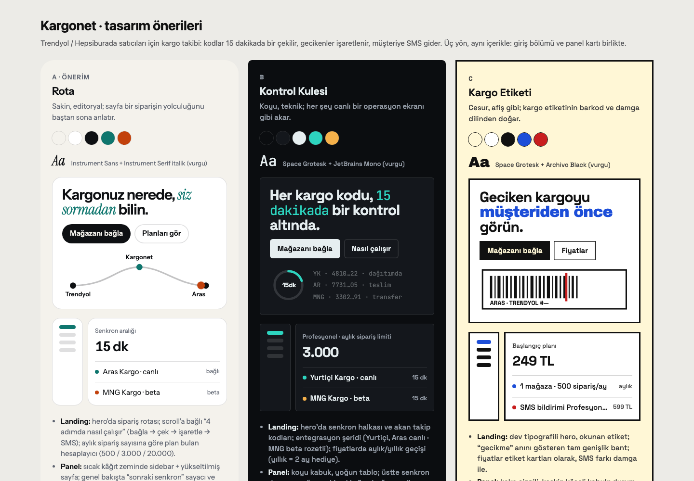

# premium-ui

**Claude Code için tasarım skill'i: ürüne özgü, premium arayüzler ve ürünü anlatan animasyonlar.**

Tanıtım (landing) sayfaları ile uygulama panelleri, dashboard'lar ve yönetim
ekranları için çalışır. Mevcut bir projenin içinde devreye girer, projeyi
okur, birkaç tasarım yönü önerir, seçtiğiniz yönü uygular ve tarayıcıda
kontrol eder.



*Örnek bir Next.js projesi (kurgusal QR menü ürünü "Masada") için üretilen
öneri panosu. Yönler ürünün kendi dünyasından türetildi: logodaki domates ve
fesleğen, esnaf lokantasının kareli örtüsü, mutfakla salon arasındaki servis
kapısı. Rakamlar projenin config dosyalarından geliyor.*

---

## Neden

Yapay zekâyla üretilen arayüzler birbirine benzer: aynı krem zemin ve italik
serif, aynı koyu "kontrol paneli", aynı mor gradyan. premium-ui bunun tersini
hedefler:

- **Ürünün dünyasından tasarım.** Yönler hazır bir stil listesinden değil;
  ürünün nesnelerinden, kitlesinden ve mevcut marka varlıklarından türetilir.
- **Anlatan animasyon.** Her büyük animasyon ürünün gerçekten yaptığı bir
  şeyi gösterir. Gösteremeyen animasyon çıkarılır.
- **Gerçek veri.** Fiyat, limit ve süreler projeden okunur. Müşteri sayısı,
  referans ya da "ücretsiz dene" gibi teklifler uydurulmaz.
- **Ölçülen kalite.** Kontrast, taşma, odak, tıklama alanı ve reduced-motion
  her bölümde bir script ile ölçülür, ardından ekran görüntüsüne bakılarak
  görsel kontrol yapılır.
- **Öğrenen skill.** Önceki çalışmalarda kullanılan fontları ve metaforları,
  kullanıcının seçimlerini ve tekrar eden hataları hatırlar; aynı şeyi
  tekrar önermez.

## Nasıl çalışır

1. **Hatırlar.** Önceki oturumlarda öğrendiği kuralları, kullanılmış font ve
   metaforları, bu projede daha önce gösterilenleri okur.
2. **Kapsamı belirler.** Tüm sayfa mı, panel mi, tek bölüm mü, yoksa tek
   bir bileşen ailesi mi (yalnızca inputlar, butonlar, tablolar)? Yalnızca
   isteneni yapar; istenmeyen bölüm ya da footer eklemez.
3. **Projeyi inceler.** Stack'i tespit eder (Laravel/Livewire, React/Next,
   Vue/Nuxt…); ürünün ne yaptığını, mevcut ekranları, bileşen kütüphanesini
   ve gerçek rakamları çıkarır.
4. **Öneri panosu hazırlar.** 2–3 farklı tasarım yönünü tek sayfada canlı
   mini tasarımlar olarak gösterir: palet, yazı tipleri, mini giriş bölümü,
   mini panel ve çalışan imza animasyonu. Landing için altına **sayfa
   kurgusunu** ekler: 5–8 sahne, her biri ziyaretçinin bir sorusuna cevap,
   yan yana iki sahne aynı düzende değil. Bileşen isteklerinde bunun yerine
   bileşenin 2–3 varyantını tüm durumlarıyla (odak, hata, devre dışı,
   yükleniyor…) açık ve koyu gösterir.
5. **Göstermeden önce kontrol eder.** Masaüstü ve mobil ekran görüntüsü,
   okunurluk ve kırık yerler, sekiz maddelik seviye kontrolü (sahneler,
   marka motifi, gerçek görseller, gerçek veriden görselleştirme, detaylar,
   tipografi, hareket, tekrar). 16 üzerinden 12'nin altındaysa göstermeden
   önce iyileştirir. Ardından sanat yönetmeni, hareket tasarımcısı ve
   erişilebilirlik gözüyle üç eleştiri ve "bunu yapay zekâ yapmış gibi
   duruyor mu?" testi.
6. **Seçilen yönü uygular.** Önce token'lar (renk, tip, şekil, boşluk), sonra
   bölüm bölüm. Her bölüm tarayıcıda masaüstü ve mobilde, açık ve koyu
   modda doğrulanır.
7. **Öğrenir.** Seçimleri, geri bildirimleri, kullandığı sayfa hareketlerini
   (footer yazısı, sabitlenen adımlar, carousel…) ve bulunan hataları
   kaydeder. Son projelerde kullandığı hareketi gerekçe olmadan tekrar
   kullanmaz; oturum sonunda öğrendiklerini kalıcı kurallara dönüştürür.

## Kurulum

### Gereksinimler

| | Gerekli mi | Ne için |
| --- | --- | --- |
| [Claude Code](https://claude.com/claude-code) | Evet | Skill'i çalıştırır |
| Python 3.8+ | Önerilir | Hafıza, font kontrolü ve ekran görüntüsü script'leri (yalnızca standart kütüphane) |
| Google Chrome, Chromium, Edge veya Brave | İsteğe bağlı | Tarayıcı aracı olmayan ortamlarda ekran görüntüsü (`snapshot.py`) |
| `fonttools` ve `brotli` | İsteğe bağlı | Font dosyalarında Türkçe karakterlerin kesin kontrolü |

İsteğe bağlı Python paketleri:

```bash
pip install fonttools brotli
```

### Plugin olarak (önerilen)

Claude Code içinde:

```text
/plugin marketplace add karaarslaneren/premium-ui
/plugin install premium-ui@premium-ui
```

Ya da terminalden:

```bash
claude plugin marketplace add karaarslaneren/premium-ui
```

```bash
claude plugin install premium-ui@premium-ui
```

Kurulumdan sonra Claude Code'u yeniden başlatın. `/premium-ui` komutu
listede görünüyorsa skill hazırdır.

### Güncelleme

```bash
claude plugin update premium-ui@premium-ui
```

Skill'in hafızası plugin klasörünün dışında tutulduğu için güncelleme
öğrendiklerini silmez.

### Elle kurulum (plugin sistemi olmadan)

Repoyu klonlayıp skill klasörünü kişisel skill dizininize kopyalayın:

```bash
git clone https://github.com/karaarslaneren/premium-ui.git
```

```bash
cp -R premium-ui/skills/premium-ui ~/.claude/skills/
```

Skill'i yalnızca tek bir projede kullanmak için `~/.claude/skills/` yerine
o projenin `.claude/skills/` klasörüne kopyalayın.

## Kullanım

Doğrudan çağırın:

```text
/premium-ui Bu projenin tanıtım sayfasını ve panelini yeniden tasarla.
```

Ya da isteğinizi normal yazın. "Premium", "profesyonel", "animasyonlu",
"şık", "yeniden tasarla" gibi ifadeler ya da bir referans siteyle birlikte
"bu tarzda" demek skill'i kendiliğinden devreye sokar.

Örnek istekler:

```text
Tanıtım sayfası çok sade kaldı, premium ve animasyonlu bir landing istiyorum. Panel de toparlansın.
```

```text
Dashboard yer tutucu kutulardan oluşuyor, gerçek verilerle profesyonel bir genel bakış ekranı yap.
```

```text
Projedeki form inputları çok sıradan, sadece inputları premium yap.
```

```text
Şu sitenin hissini seviyorum: https://… Bizim ürüne uygun bir şey öner, kopyalama.
```

Skill önce öneri panosunu gösterir ve hangi yönü istediğinizi sorar.
Doğrudan uygulamasını istiyorsanız "sen seç" ya da "direkt yap" demeniz
yeterli. Ayrıntılı bir brief vermek isterseniz
[`prompt-template.md`](skills/premium-ui/references/prompt-template.md)
şablonunu doldurun.

**Kullanılmadığı durumlar:** tek bir değer düzeltmesi (bir renk, bir
boşluk), backend işleri, logo ve görsel üretimi, sunumlar ve tek başına
grafikler.

## Hafıza

Skill her oturumda öğrendiklerini `~/.claude/premium-ui/` altında tutar:

- `journal.jsonl`: gösterilen panolar (yön adları, fontlar, ton), seçimler,
  kullanıcının geri bildirimleri ve bulunan hatalar.
- `lessons.md`: bunlardan çıkarılan kısa, kalıcı kurallar. Elle
  düzenleyebilirsiniz.

Bu dosyalar sizin makinenizde kalır. Yalnızca siz onaylarsanız anonim bir
özeti paylaşılır (aşağıda).
Konumu `PREMIUM_UI_HOME` ortam değişkeniyle değiştirebilir,
`PREMIUM_UI_MEMORY=off` ile hafızayı tamamen kapatabilirsiniz. Tek bir
oturum için "bunu hatırlama" demeniz de yeterli.

## Öğrendiklerini paylaşma

Skill'in sizin projelerinizde öğrendikleri, onay verirseniz herkese
ulaşabilir:

1. Skill yeterince şey öğrendiğinde oturum sonunda bir kez sorar: "Bu
   öğrendiklerimi anonim olarak premium-ui'ye göndereyim mi?" İstediğiniz zaman
   "premium-ui öğrendiklerini paylaş" diyerek de başlatabilirsiniz.
2. Göndermeden önce raporun tamamını görürsünüz. Raporda öğrenilen kurallar, hata
   türlerinin sayıları, kullanılan fontlar ve seçilen yönlerin açık/koyu ve
   köşe dağılımı bulunur. Proje adları, sözleriniz, dosya yolları ve kod
   bulunmaz.
3. Onaylarsanız rapor bu repoda `[öğrenilenler]` başlıklı bir issue olarak açılır.
   `gh` kuruluysa doğrudan; değilse önceden doldurulmuş bir bağlantıyla,
   "Submit"e siz basarsınız.
4. Gelen raporlar derlenir, birden fazla kullanıcıdan gelen kurallar ve
   hatalar skill'e eklenir ve bir sonraki sürümle herkese ulaşır.

"Bir daha sorma" derseniz bir daha sorulmaz.

## İçerik

| Dosya | Ne işe yarar |
| --- | --- |
| [`SKILL.md`](skills/premium-ui/SKILL.md) | Çalışma yöntemi: hatırlama, öneri, ürün gerçekleri, token'lar, bölüm bölüm uygulama, doğrulama, öğrenme |
| [`direction-finding.md`](skills/premium-ui/references/direction-finding.md) | Tasarım yönlerini ürünün dünyasından türetme; her projede aynı görünümün çıkmasını önleyen eksenler, kurallar ve testler |
| [`type-library.md`](skills/premium-ui/references/type-library.md) | Türlere göre gruplanmış ~125 Google Fonts yazı tipi, karakter notlarıyla; hepsinde Türkçe karakterler doğrulandı |
| [`proposal-board.md`](skills/premium-ui/references/proposal-board.md) | Tasarım yönlerini canlı mini tasarımlarla önerme |
| [`motion-catalog.md`](skills/premium-ui/references/motion-catalog.md) | Animasyon teknikleri ve hazır kodları: scroll reveal, line mask, count-up, SVG akış, sabitlenen bölüm, magnetic buton, glow kart, plan önerici, carousel |
| [`panel-patterns.md`](skills/premium-ui/references/panel-patterns.md) | Panel çerçevesi, bileşen kütüphanesini merkezden temalama, gerçek verili dashboard, giriş ekranları, dil ayarları |
| [`craft-baseline.md`](skills/premium-ui/references/craft-baseline.md) | Tip ve boşluk ölçekleri, erişilebilirlik, performans bütçesi, metin, yükleniyor/boş/hata durumları |
| [`high-end.md`](skills/premium-ui/references/high-end.md) | Üst düzey bir sitenin farkı: sahne kurgusu, marka motifi, gerçek görseller, gerçek veriden etkileşimli görselleştirme, detaylar, koreografi; seviye kontrolü |
| [`motion-engine.md`](skills/premium-ui/references/motion-engine.md) | Kaydırmaya bağlı, koreografili hareket: GSAP + ScrollTrigger, CSS scroll timeline, View Transitions ile sayfa geçişleri, koreografi token'ları, hareket bütçesi |
| [`art-direction.md`](skills/premium-ui/references/art-direction.md) | Görsel envanteri, tüm fotoğraflara tek işlem (grade, duotone, grain, marka maskesi), fotoğraf yoksa çekim listesi, gerçek veriden SVG görseller, görsel olarak tipografi |
| [`copy.md`](skills/premium-ui/references/copy.md) | Tasarımı taşıyan başlıklar: kalıplar, yasak klişeler, sahne metni düzeni |
| [`webgl.md`](skills/premium-ui/references/webgl.md) | İsteğe bağlı 3D katmanı: ne zaman değer, three.js, cihaz kademeleri, yedek |
| [`component-craft.md`](skills/premium-ui/references/component-craft.md) | Tek bileşen ailesi istendiğinde: kapsam kuralları, durum matrisi, varyantlar; input, select, checkbox, buton, tablo tarifleri |
| [`visual-critique.md`](skills/premium-ui/references/visual-critique.md) | Panoyu ve her bölümü kullanıcıdan önce görmek: ekran görüntüsü, altı soru, düzelt ve tekrar çek |
| [`learning.md`](skills/premium-ui/references/learning.md) | Oturumlar arası hafıza: neyin hatırlanacağı, ne zaman kaydedileceği, kuralların nasıl çıkarılacağı |
| [`pitfalls.md`](skills/premium-ui/references/pitfalls.md) | Gerçekte yaşanmış, stack'ten bağımsız hatalar ve çözümleri |
| [`stacks/`](skills/premium-ui/references/stacks/) | Stack'e özel tarifler ve hatalar: [Laravel/Livewire/Flux](skills/premium-ui/references/stacks/laravel-livewire.md), [React/Next/shadcn](skills/premium-ui/references/stacks/react-next.md), [Vue/Nuxt](skills/premium-ui/references/stacks/vue-nuxt.md) |
| [`prompt-template.md`](skills/premium-ui/references/prompt-template.md) | Doldurulacak istek şablonu |
| [`assets/proposal-board.html`](skills/premium-ui/assets/proposal-board.html) | Öneri panosu şablonu: 3 yön, mini giriş bölümü ve panel, CSS animasyonu, sayfa kurgusu |
| [`assets/component-board.html`](skills/premium-ui/assets/component-board.html) | Bileşen panosu şablonu: varyantlar × durumlar, açık ve koyu |
| [`scripts/verify.js`](skills/premium-ui/scripts/verify.js) | Tarayıcıda çalışan denetim: yatay taşma, tıklama alanı, kontrast, odak, reduced-motion, görsel ve font kontrolleri (JSON rapor) |
| [`scripts/study.js`](skills/premium-ui/scripts/study.js) | Referans siteyi ölçer: sahneler, sabitlenen bölümler, tip ölçeği, palet, hareket kütüphaneleri, detaylar |
| [`scripts/scenes.mjs`](skills/premium-ui/scripts/scenes.mjs) | Kaydırmaya bağlı sayfalar için: headless Chrome'da gerçek zamanlı kaydırıp her ekranın görüntüsünü alır (Node 22+) |
| [`scripts/snapshot.py`](skills/premium-ui/scripts/snapshot.py) | Tarayıcı aracı yokken makinedeki Chrome ile masaüstü ve mobil ekran görüntüsü alır, `verify.js` raporunu verir |
| [`scripts/check-fonts.py`](skills/premium-ui/scripts/check-fonts.py) | Seçilen Google Fonts yazı tiplerinde Türkçe karakterlerin (ğ ş ı İ…) gerçekten olup olmadığını kontrol eder |
| [`scripts/learn.py`](skills/premium-ui/scripts/learn.py) | Hafıza: başta `recall`, oturum sırasında `board` / `choice` / `feedback` / `issue`, sonda `lesson`; `share` ile onaylı, anonim paylaşım |
| [`tools/collect-lessons.py`](tools/collect-lessons.py) | Bakımcı için: kullanıcıların paylaştığı `[öğrenilenler]` issue'larını toplar, skill'e eklenecekleri önerir |

## İlkeler

- Animasyonlar süs değil, ürünün ne yaptığını anlatır.
- Referans site kopyalanmaz; yalnızca kalitesi örnek alınır.
- Rakamlar ve iddialar gerçek veriden gelir, uydurulmaz.
- Yalnızca transform/opacity animasyonu, `prefers-reduced-motion` desteği,
  mobilde yatay taşma yok.
- WCAG AA kontrast, görünür odak, klavyeyle kullanım.
- Her değişiklik tarayıcıda gerçek etkileşimle kontrol edilir.
- Skill kendi yaptıklarından öğrenir; aynı fontu ve metaforu tekrar etmez,
  reddedilen yönü yeniden önermez.

## Geliştirme

- Paylaşılan öğrenilenleri derlemek için:

  ```bash
  python3 tools/collect-lessons.py
  ```

  `gh` ile açık `[öğrenilenler]` issue'larını okur. Birden fazla kullanıcının yazdığı
  kuralları, `pitfalls.md`'de olmayan hata türlerini ve † ile
  işaretlenmemiş ama sık kullanılan fontları gösterir. Bir rapordaki bilgi
  sürüme girince issue'yu kapatın.

- Test senaryoları `skills/premium-ui/evals/` altında (`claude plugin eval`
  formatında); tetiklenme sorguları
  [`evals/trigger-queries.json`](evals/trigger-queries.json) içinde.
- Sürüm notları: [`CHANGELOG.md`](CHANGELOG.md).
- Hata ve öneriler için
  [GitHub Issues](https://github.com/karaarslaneren/premium-ui/issues).
